# Cloudflare setup

English | [中文](../zh-CN/cloudflare.md)

The Worker façade turns the rotating quick tunnel into a **permanent public
URL** for the ChatGPT connector. One-time setup in the Cloudflare dashboard;
the free tier is more than enough (100k requests/day, KV included).

```
start.sh ──PUT /_upstream──> Worker (dsh-gw.<you>.workers.dev)
                                 │  stores tunnel URL in KV (UPSTREAM)
                                 ▼
ChatGPT ──all other requests──>  proxied verbatim to the current tunnel
```

## Steps

### 1. Create the Worker

**(1) [Cloudflare dashboard](https://dash.cloudflare.com) → Compute → Workers & Pages → Create application →**
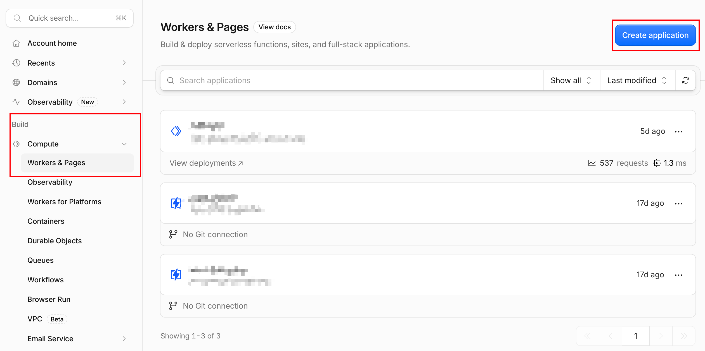

**(2) Start with Hello World! →**
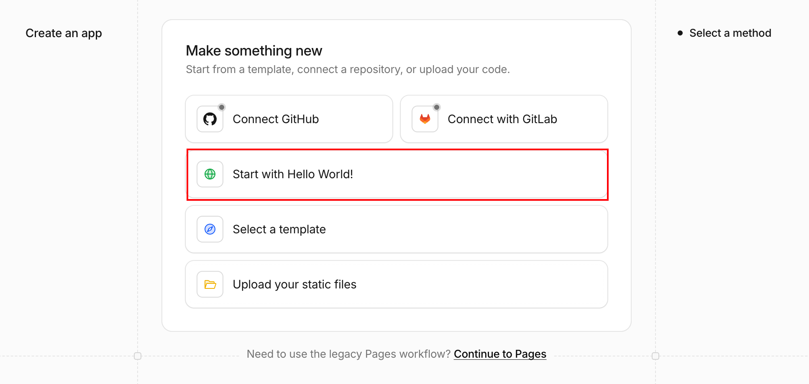

**(3) Worker name `dsh-gw` → Deploy (ignore the hello-world code for now) →**
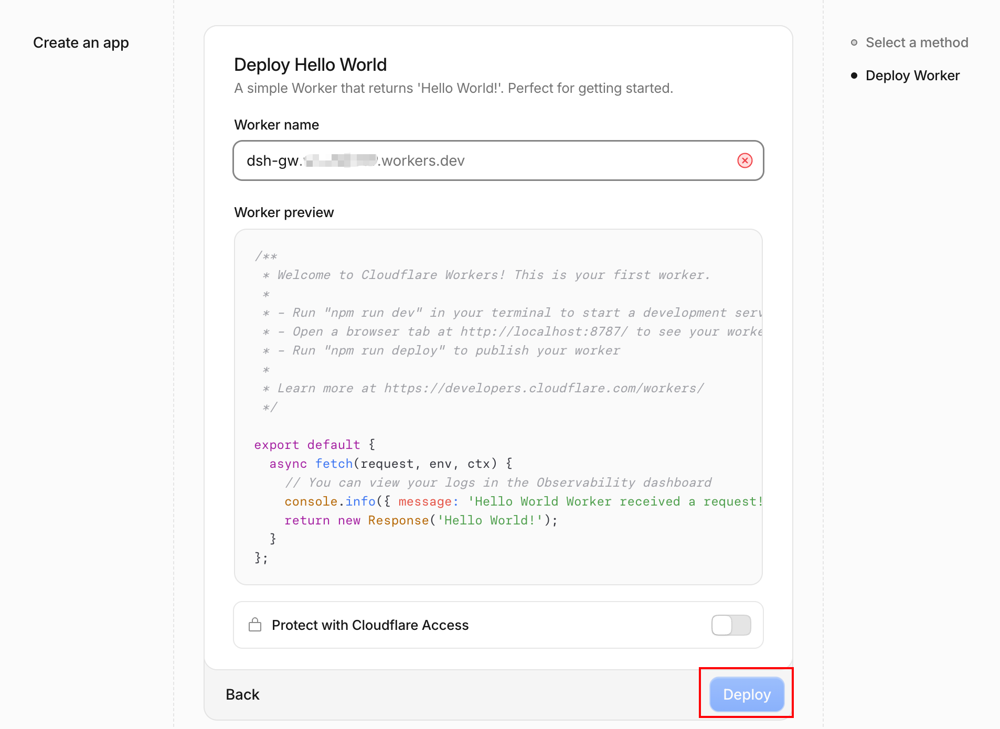

**(4) Open the worker → Edit code →**
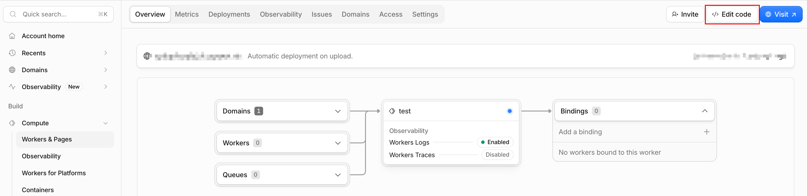

**(5) Replace the entire contents with `worker/_worker.js` → Deploy**
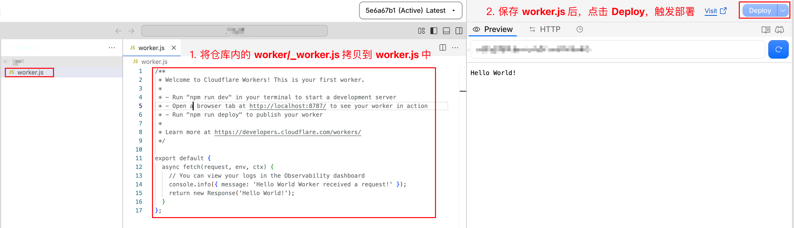

### 2. Create the KV namespace

**[Cloudflare dashboard](https://dash.cloudflare.com) → Storage & databases → Workers KV → Create a KV namespace** — name it e.g.
`dsh-gw-upstream`. The namespace name is yours; what matters is the
**binding name** in the next step.
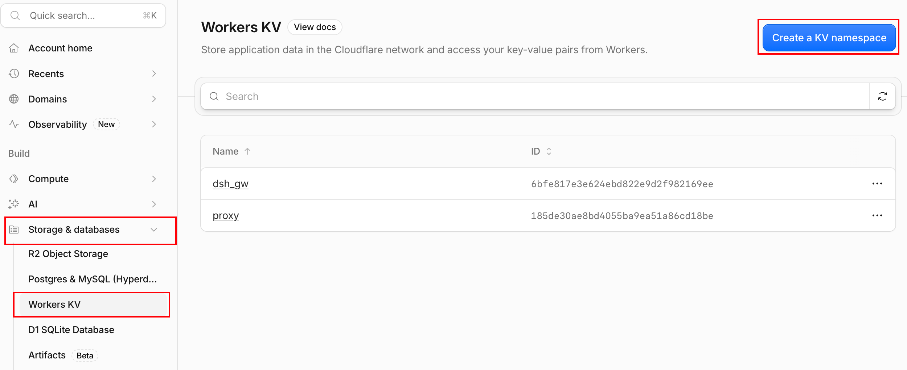
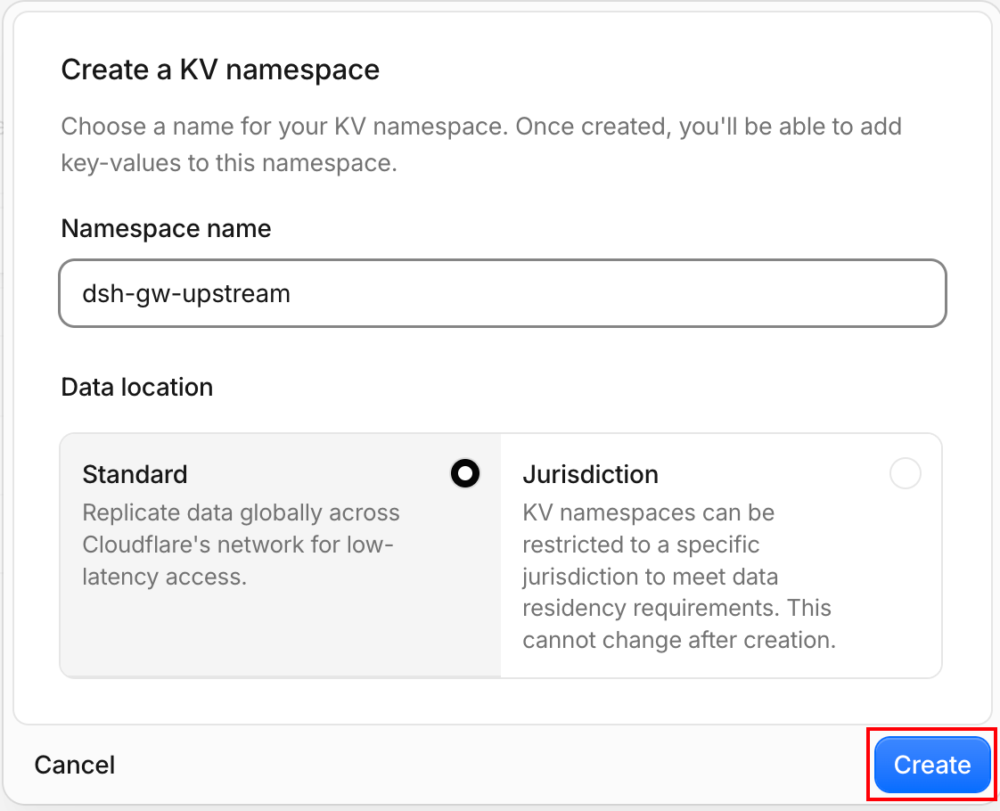

### 3. Bind KV to the Worker as `UPSTREAM`

**Back to the worker → Settings → Bindings → Add binding → KV namespace →**
variable name **`UPSTREAM`** (exact — the code reads `env.UPSTREAM`) →
select the `dsh-gw-upstream` you just created → save.
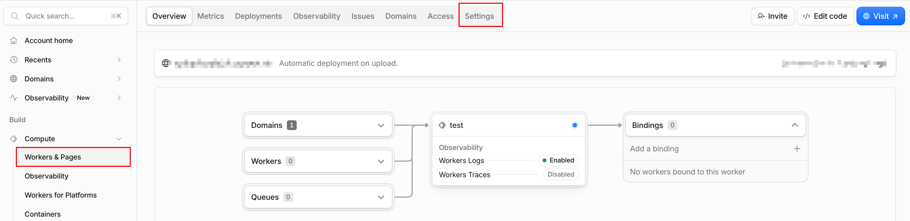
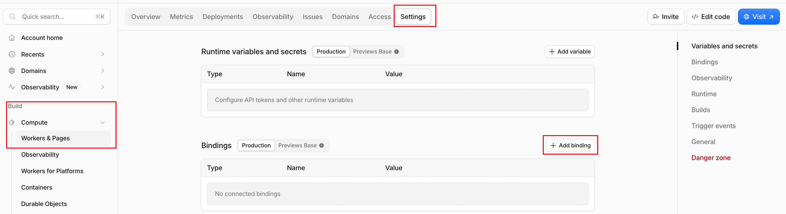
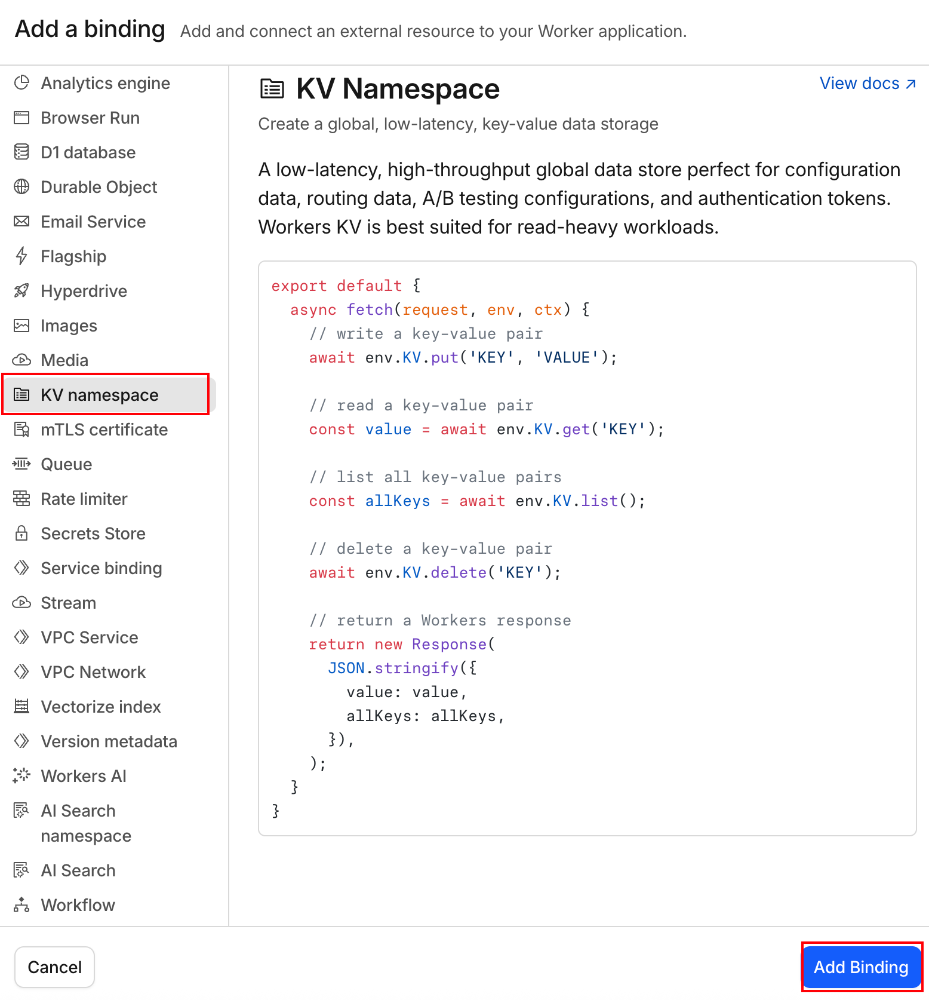
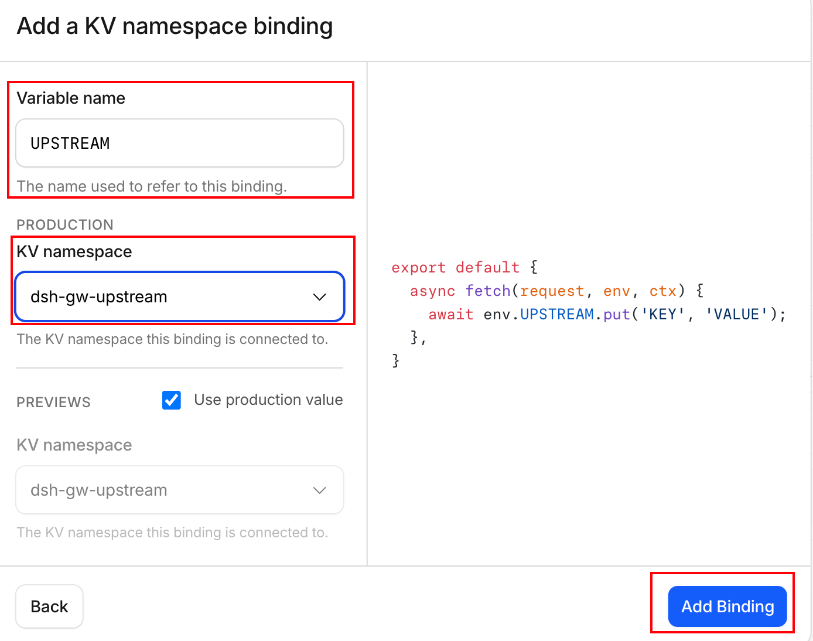

### 4. Add the `ADMIN_SECRET`

**Back to the worker → Settings → Variables and Secrets → Add →**
type **Secret** → name **`ADMIN_SECRET`** →

It is the only credential protecting `PUT /_upstream` — the endpoint that
repoints the public URL at a new tunnel.
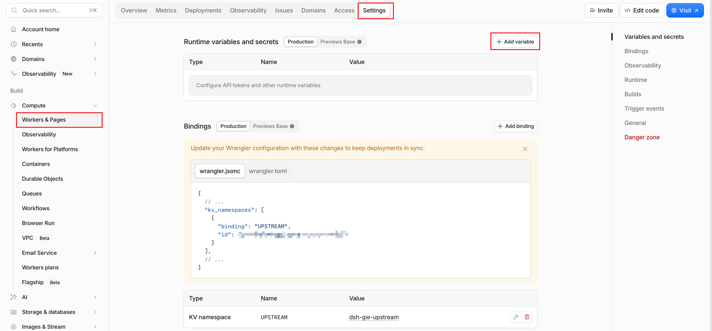
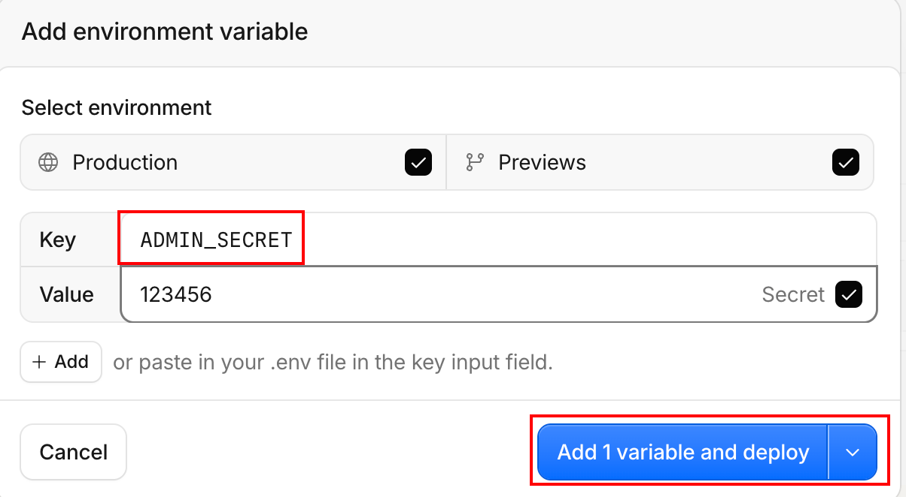

### 5. Fill `~/.dsh-mcp-gateway/env.conf` (auto-created by install.sh / install.ps1)

The worker's URL is shown on its overview page
(`https://dsh-gw.<subdomain>.workers.dev`). In env.conf:

```bash
WORKER_PUBLIC_URL=https://dsh-gw.<subdomain>.workers.dev
UPSTREAM_ADMIN_SECRET=<the same string as ADMIN_SECRET>
```

WORKER_PUBLIC_URL is the red-boxed field below:
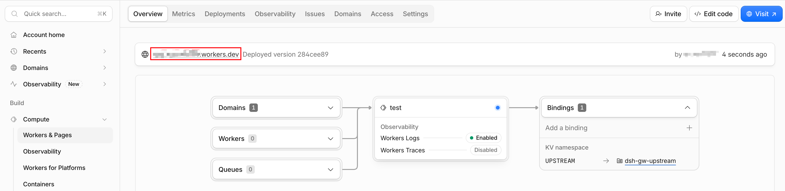

UPSTREAM_ADMIN_SECRET is the ADMIN_SECRET value set above.

## Verify

```bash
# KV binding + code wired? (expected: "upstream not registered yet", HTTP 503)
curl -i "$WORKER_PUBLIC_URL/"

# Admin endpoint protected? (expected: "forbidden", HTTP 403)
curl -i -X PUT "$WORKER_PUBLIC_URL/_upstream" \
  -H "Authorization: Bearer wrong" -d "https://x.trycloudflare.com"
```

Then run `start.sh` — its "published to worker facade" line means the PUT
succeeded. Final check (full chain Worker → tunnel → gateway):

```bash
curl "$WORKER_PUBLIC_URL/.well-known/oauth-authorization-server"   # OAuth JSON
```

## Troubleshooting

| Symptom | Cause |
|---|---|
| `KV binding UPSTREAM is not configured` (500) | binding missing or misnamed — must be exactly `UPSTREAM` |
| `upstream not registered yet` (503) after `start.sh` | the `/_upstream` PUT failed — check `UPSTREAM_ADMIN_SECRET` and `PROXY` in env.conf |
| `forbidden` (403) on PUT | secret mismatch between Worker and env.conf |
| Worker URL unreachable from your machine | network blocks `*.workers.dev` — set `PROXY=` for the launcher (ChatGPT is unaffected) |

## Security notes

- The Worker terminates TLS — it sees request/response **plaintext**. That is
  why OAuth + owner PIN sits inside the payload (`/mcp` is Bearer-protected);
  tunnel-URL leakage alone grants nothing.
- `ADMIN_SECRET` only guards `PUT /_upstream`; every other path is proxied
  verbatim. A leaked secret lets an attacker repoint your façade at *their*
  upstream — rotate it if that ever happens (update both the Worker secret
  and `env.conf`).
- KV stores exactly one value: the current tunnel origin. No credentials,
  no traffic data.
