# Cloudflare 配置

[English](../en/cloudflare.md) | 中文

Worker 门面把轮换的 quick tunnel 变成一个**永久不变的公网 origin** 给
各 MCP 客户端连接器用。在 Cloudflare 控制台一次性配置；免费套餐绰绰有余
(每天 10 万请求，含 KV)。

```
start.sh ──PUT /_upstream──> Worker (dsh-gw.<you>.workers.dev)
                                 │  tunnel URL 存进 KV(UPSTREAM)
                                 ▼
MCP 客户端 ──其他所有请求──>   原样代理到当前 tunnel
```

## 步骤

### 1. 创建 Worker

 **(1) 在 [Cloudflare 控制台](https://dash.cloudflare.com) → Compute -> Workers & Pages → create application →**
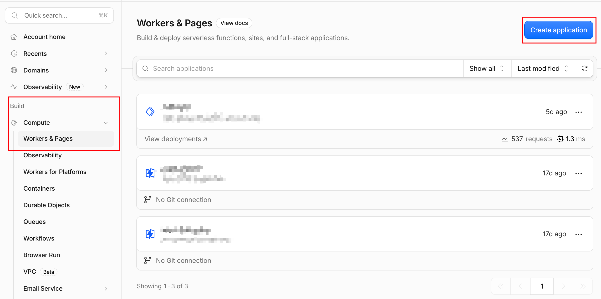

**(2)Start with a Hello World! →** 
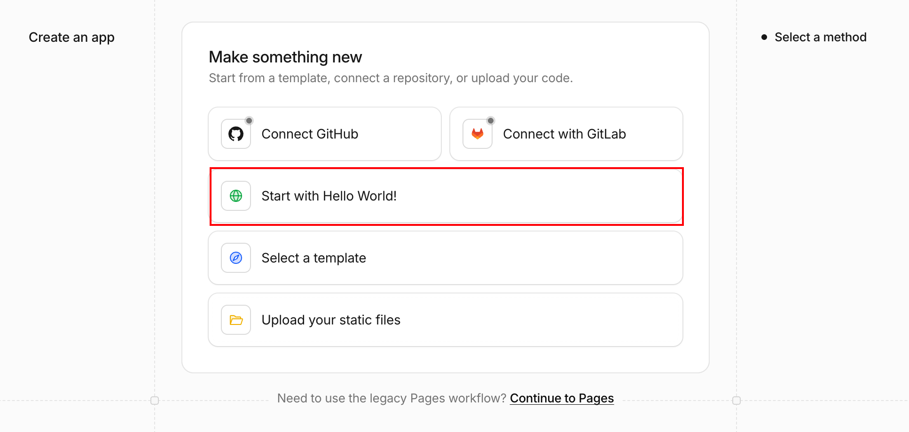

**(3)Worker Name 命名 `dsh-gw.xxxx.workers.dev` → Deploy（先不管预先提供的 hello-world 代码） →**

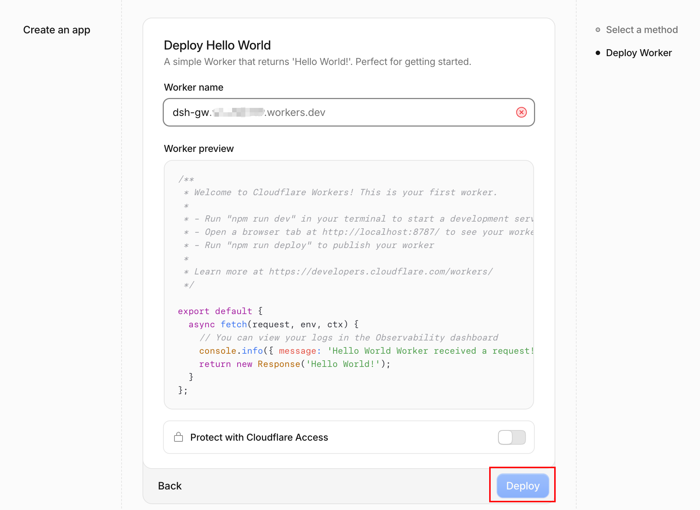

**(4)然后打开这个 worker → Edit code →** 
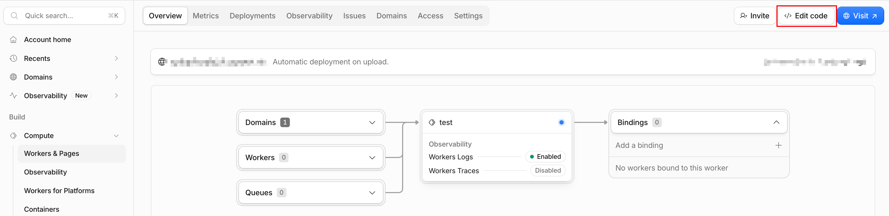

**(5)把内容整个换成 `worker/_worker.js` → Deploy**。
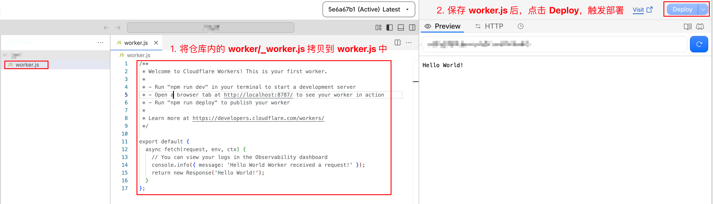


### 2. 创建 KV 命名空间

 **在 [Cloudflare 控制台](https://dash.cloudflare.com) → Storage & databases -> Workers KV → Create a KV namespace** → 命名如
`dsh-gw-upstream`。命名空间名字随意，关键是下一步的**绑定名**。
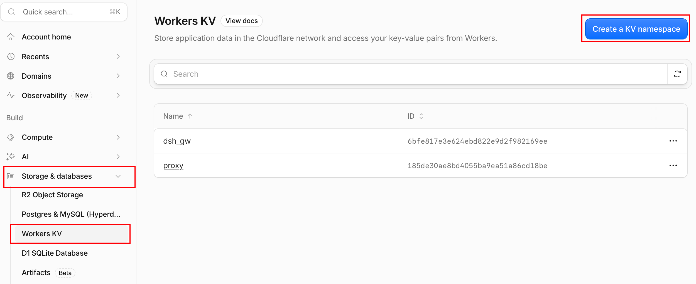
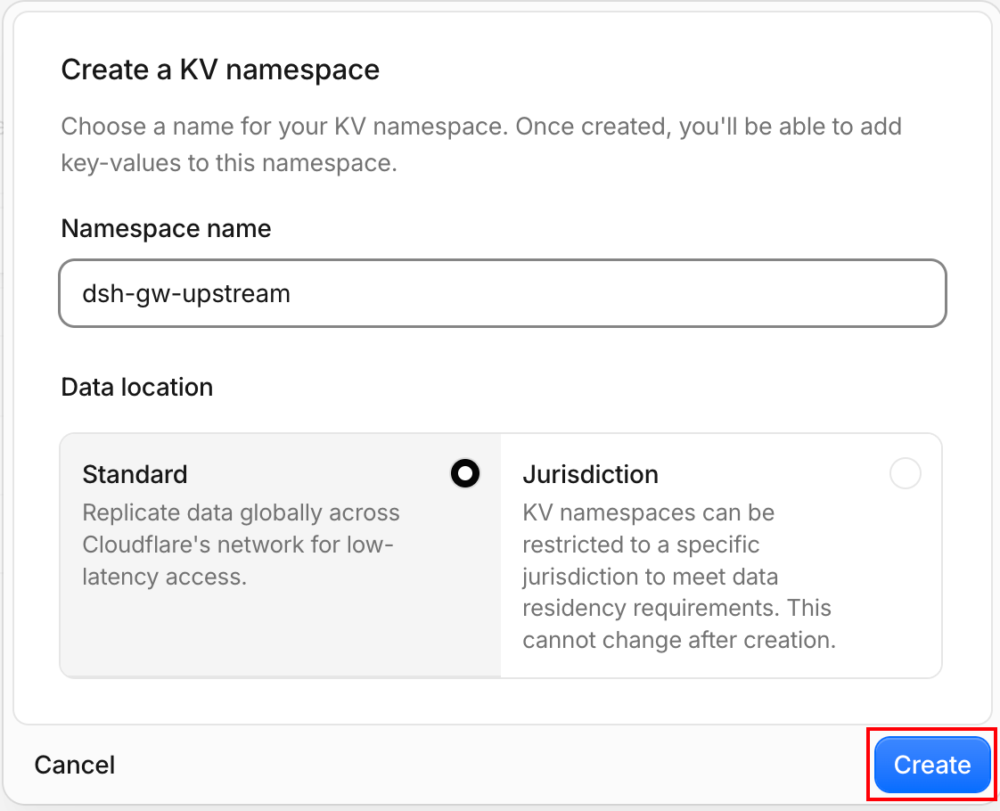

### 3. 把 KV 绑定为 `UPSTREAM`

**回到前面的 worker → Settings → Bindings → Add binding → KV namespace →**
变量名 **`UPSTREAM`**（必须一字不差 —— 因为代码读 `env.UPSTREAM`)→
选中刚才创建的 `dsh-gw-upstream` → 保存。
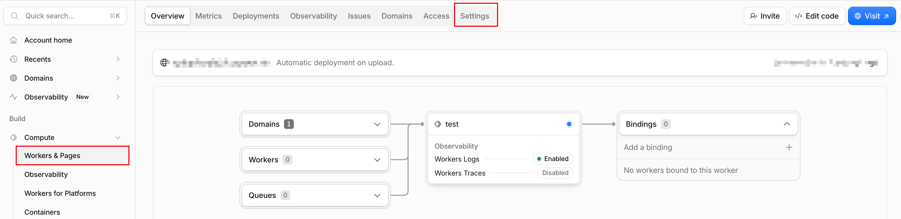
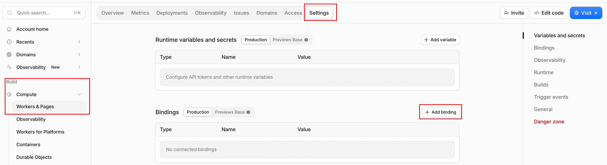
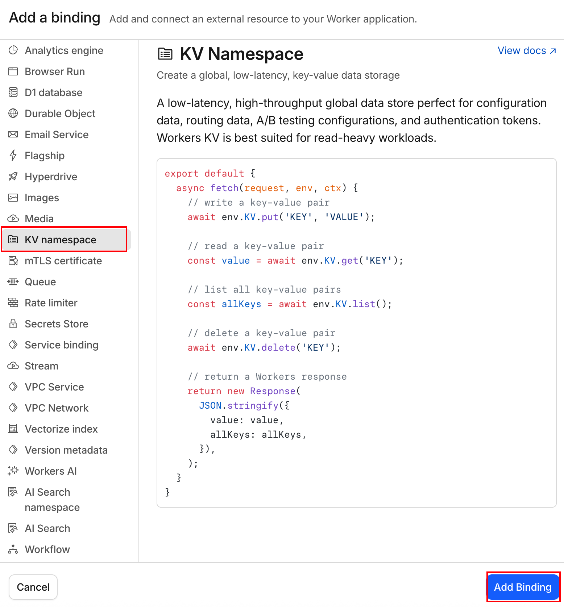
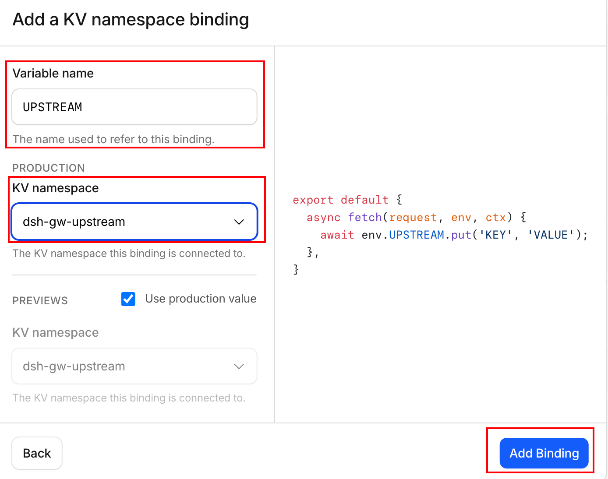
### 4. 添加 `ADMIN_SECRET`

**回到前面的 worker → Settings → Variables and Secrets → Add →**
类型选 **Secret** → 名字 **`ADMIN_SECRET`** → 

它是保护 `PUT /_upstream` 的唯一凭据 —— 那个端点会把公网 URL 重指到
新 tunnel。
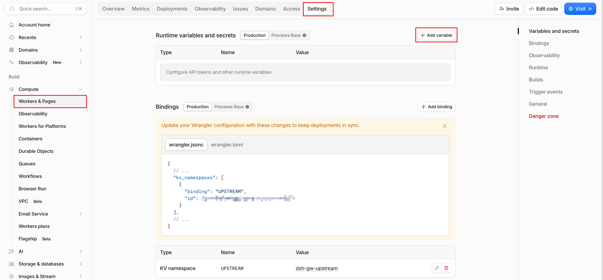
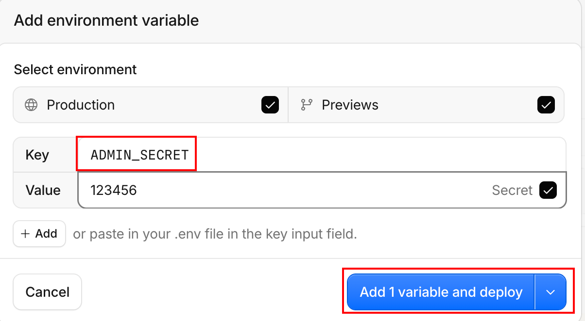

### 5. 填 $HOME/.dsh-mcp-gateway/env.conf（该文件在执行 install.ps1 或 install.sh 后会自动创建）

worker 的 URL 在它的概览页能看到
(`https://dsh-gw.<subdomain>.workers.dev`)。在部署目录的 env.conf 里：

```bash
WORKER_PUBLIC_URL=https://dsh-gw.<subdomain>.workers.dev
UPSTREAM_ADMIN_SECRET=<与 ADMIN_SECRET 相同的串>
```

WORKER_PUBLIC_URL 为下方红色方框标记处 
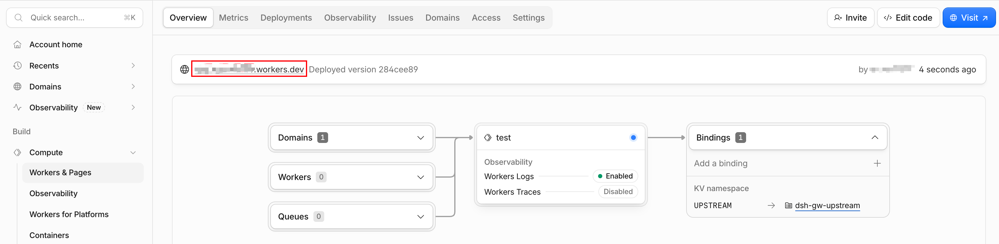

UPSTREAM_ADMIN_SECRET 为前面设定的 ADMIN_SECRET 值
## 验证

```bash
# KV 绑定 + 代码接好了吗?(预期: "upstream not registered yet",HTTP 503)
curl -i "$WORKER_PUBLIC_URL/"

# 管理端点有保护吗?(预期: "forbidden",HTTP 403)
curl -i -X PUT "$WORKER_PUBLIC_URL/_upstream" \
  -H "Authorization: Bearer wrong" -d "https://x.trycloudflare.com"
```

然后跑 `start.sh` —— 输出 "published to worker facade" 即 PUT 成功。
最后验证全链路(Worker → tunnel → 网关):

```bash
curl "$WORKER_PUBLIC_URL/.well-known/oauth-authorization-server"   # 返回 OAuth JSON
curl "$WORKER_PUBLIC_URL/.well-known/oauth-protected-resource/chatgpt/mcp"
# 返回 resource = "$WORKER_PUBLIC_URL/chatgpt/mcp" 的 JSON,说明路径感知发现在线
```

## 排错

| 症状 | 原因 |
|---|---|
| `KV binding UPSTREAM is not configured`(500) | 绑定没建或名字写错 —— 必须正好是 `UPSTREAM` |
| `start.sh` 之后仍 `upstream not registered yet`(503) | `/_upstream` PUT 失败 —— 查 env.conf 里的 `UPSTREAM_ADMIN_SECRET` 和 `PROXY` |
| PUT 返回 `forbidden`(403) | Worker 密钥与 env.conf 不一致 |
| 本机访问不了 Worker URL | 网络封 `*.workers.dev` —— 给启动器设 `PROXY=`(外部 MCP 客户端不受影响) |

## 安全说明

- Worker 终结 TLS —— 它能看到请求/响应**明文**。这正是 OAuth + owner
  PIN 做内层的原因(所有 MCP mount 都有 Bearer 保护);tunnel URL 泄露本身不授予
  任何权限。
- `ADMIN_SECRET` 只守 `PUT /_upstream`;其他路径原样代理。密钥泄露
  会让攻击者把你的门面指到*他们的*上游 —— 一旦发生就轮换(Worker
  密钥和 env.conf 一起换)。
- KV 里只存一个值:当前 tunnel 源。没有凭据,没有流量数据。
